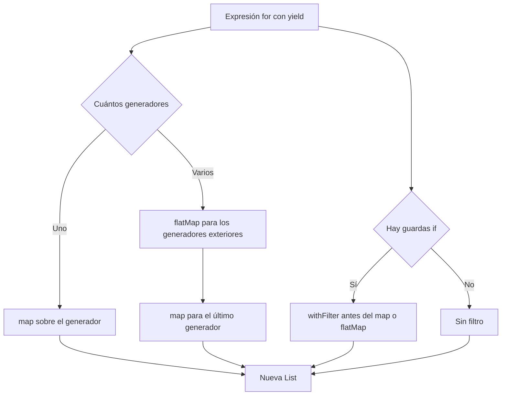
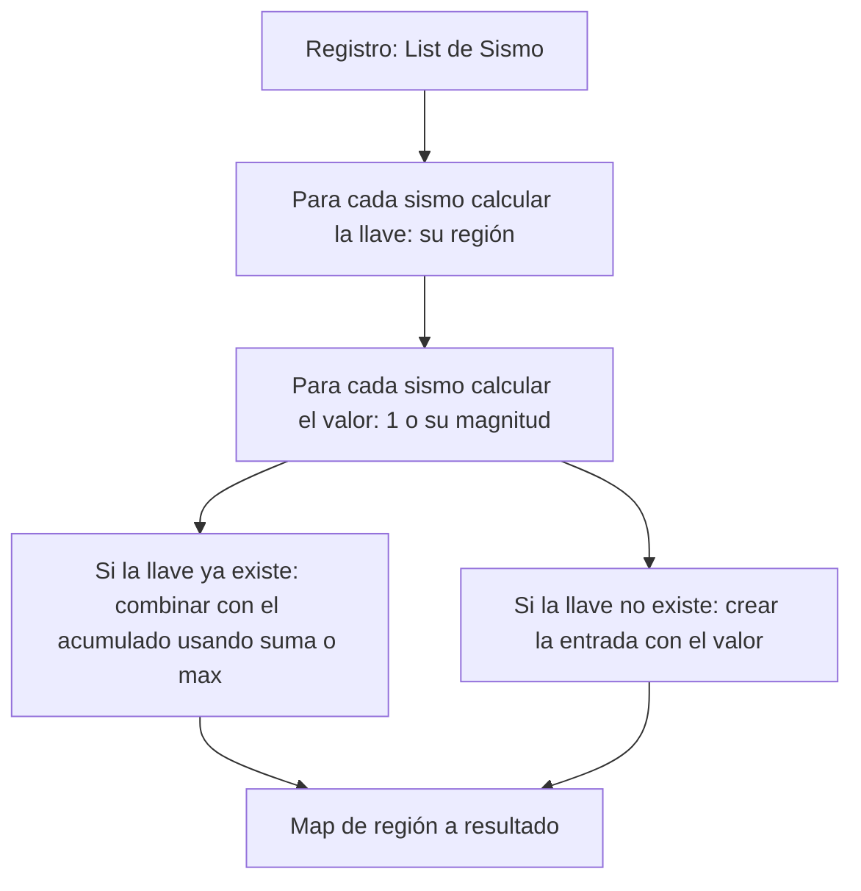
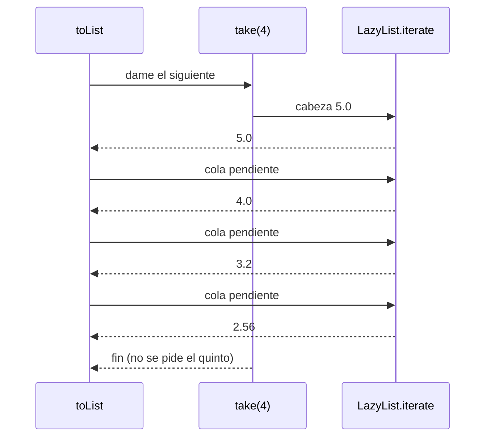

# Informe de proceso: Taller 3, registro sísmico

Este informe describe, paso a paso, cómo se ejecuta cada función del taller, y en qué operaciones se traduce cada expresión `for` utilizada. Para cada función se presenta el código, su traducción, la explicación de cada componente, una traza completa con el registro de ejemplo, los casos borde y el costo.

## 0. Convenciones y datos de ejemplo

Los tipos del modelo de datos no se modifican:

```scala
case class Fecha(anio: Int, mes: Int)
case class Sismo(fecha: Fecha, region: String, magnitud: Double, profundidad: Int)
type Registro = List[Sismo]
```

En las trazas se numeran los sismos del registro de ejemplo del enunciado del 1 al 7:

| N° | Fecha | Región | Magnitud | Profundidad |
|----|-------|--------|----------|-------------|
| 1 | 2025-03 | Valle | 4.2 | 30 |
| 2 | 2025-03 | Santander | 5.1 | 150 |
| 3 | 2025-04 | Valle | 3.8 | 25 |
| 4 | 2025-04 | Choco | 6.0 | 40 |
| 5 | 2025-05 | Santander | 4.7 | 160 |
| 6 | 2025-05 | Valle | 5.3 | 35 |
| 7 | 2025-06 | Choco | 3.1 | 20 |

Restricciones de estilo que cumplen todas las funciones: no hay variables mutables (`var`), no hay ciclos iterativos (`while` ni `for` sin `yield`) y no hay `return`. Cada función es una única expresión cuyo valor es el resultado.

---

## 1. Cómo se traduce una expresión `for`

Una expresión `for ... yield` no es un ciclo. Es una notación que el compilador reescribe, antes de generar código, en llamadas a los métodos `withFilter`, `map` y `flatMap` de la colección. La reescritura sigue reglas fijas:

| Forma escrita con `for` | Traducción del compilador |
|---|---|
| `for { x <- xs } yield f(x)` | `xs.map(x => f(x))` |
| `for { x <- xs; if p(x) } yield f(x)` | `xs.withFilter(x => p(x)).map(x => f(x))` |
| `for { x <- xs; y <- ys } yield f(x, y)` | `xs.flatMap(x => ys.map(y => f(x, y)))` |
| `for { x <- xs; y <- ys; if p(x, y) } yield f(x, y)` | `xs.flatMap(x => ys.withFilter(y => p(x, y)).map(y => f(x, y)))` |
| Dos guardas seguidas `if p; if q` | Dos `withFilter` encadenados, que equivalen a una guarda `p && q` |

Reglas generales:

1. Cada generador (`x <- xs`) introduce una variable que recorre una colección.
2. El último generador, el que va antes del `yield`, se traduce a `map`.
3. Todos los generadores anteriores se traducen a `flatMap`. Cada elemento del generador exterior produce una lista, y `flatMap` concatena todas esas listas en el orden en que se producen.
4. Cada guarda (`if`) se traduce a `withFilter`, aplicado sobre el generador que la precede.
5. Cuando el patrón del generador es una tupla, como `(a, i) <- ...`, el compilador lo traduce a una función con `case` (`{ case (a, i) => ... }`). En Scala 2.13 puede añadir además un `withFilter` que comprueba que el elemento tenga la forma de tupla; para pares siempre se cumple, por lo que no cambia el resultado.

Un detalle sobre `withFilter`: a diferencia de `filter`, no construye una lista intermedia con los elementos que pasan. Devuelve un objeto que aplica la condición en el momento en que se ejecuta el `map` o `flatMap` siguiente. Por eso la traducción del `for` con guarda recorre la lista una sola vez.



---

## 2. Punto 1: consultas con expresiones `for`

### 2.1. `fuertes(r, umbral)`

```scala
def fuertes(r: Registro, umbral: Double): List[String] = {
  for {
    s <- r
    if s.magnitud > umbral
  } yield s.region
}
```

**Traducción del `for`:**

```scala
r.withFilter(s => s.magnitud > umbral).map(s => s.region)
```

**Qué hace cada línea:**

1. `s <- r` recorre el registro de izquierda a derecha, en el orden en que están almacenados los sismos, y va asignando cada sismo a la variable `s`.
2. `if s.magnitud > umbral` es la guarda: solo continúan los sismos cuya magnitud es estrictamente mayor que el umbral. Un sismo con magnitud igual al umbral no pasa.
3. `yield s.region` produce, por cada sismo que pasó la guarda, el nombre de su región. La lista resultante tiene un elemento por cada sismo que pasó.

**Traza** de `fuertes(registro, 5.0)`:

| Sismo | Magnitud | Condición `magnitud > 5.0` | Elemento producido |
|---|---|---|---|
| 1 | 4.2 | falsa | ninguno |
| 2 | 5.1 | verdadera | `"Santander"` |
| 3 | 3.8 | falsa | ninguno |
| 4 | 6.0 | verdadera | `"Choco"` |
| 5 | 4.7 | falsa | ninguno |
| 6 | 5.3 | verdadera | `"Valle"` |
| 7 | 3.1 | falsa | ninguno |

Resultado: `List("Santander", "Choco", "Valle")`, igual al del enunciado.

**Propiedades y casos borde:**

- El orden del resultado coincide con el orden del registro, porque el generador recorre la lista en orden y `map` conserva ese orden.
- No se eliminan repetidos: si dos sismos fuertes son de la misma región, esa región aparece dos veces. Esto es lo que pide el enunciado y por eso no se usa `distinct`.
- Si el registro es vacío, el generador no produce ningún elemento y el resultado es `List()`.
- Si el umbral es mayor que todas las magnitudes, ninguna guarda se cumple y el resultado es `List()`.
- Si el umbral es menor que todas las magnitudes, el resultado contiene una región por cada sismo del registro.

**Costo:** una pasada sobre el registro, es decir, tiempo proporcional a $n$, con $n$ el número de sismos.

---

### 2.2. `enRegion(r, region)`

```scala
def enRegion(r: Registro, region: String): List[Double] = {
  for {
    s <- r
    if s.region == region
  } yield s.magnitud
}
```

**Traducción del `for`:**

```scala
r.withFilter(s => s.region == region).map(s => s.magnitud)
```

**Qué hace cada línea:**

1. `s <- r` recorre el registro en orden.
2. `if s.region == region` deja pasar solo los sismos de la región pedida. La comparación `==` entre `String` compara el contenido, no la referencia.
3. `yield s.magnitud` proyecta la magnitud de cada sismo que pasó.

Tiene la misma estructura que `fuertes`. Cambian dos cosas: la guarda compara regiones en lugar de magnitudes, y el `yield` entrega la magnitud en lugar de la región. Por eso el tipo de retorno es `List[Double]`.

**Traza** de `enRegion(registro, "Valle")`:

| Sismo | Región | Condición `region == "Valle"` | Elemento producido |
|---|---|---|---|
| 1 | Valle | verdadera | `4.2` |
| 2 | Santander | falsa | ninguno |
| 3 | Valle | verdadera | `3.8` |
| 4 | Choco | falsa | ninguno |
| 5 | Santander | falsa | ninguno |
| 6 | Valle | verdadera | `5.3` |
| 7 | Choco | falsa | ninguno |

Resultado: `List(4.2, 3.8, 5.3)`, en el orden de aparición en el registro.

**Casos borde:**

- Una región que no está en el registro, como `"Amazonas"`, no cumple la guarda en ningún sismo, y el resultado es `List()` sin lanzar excepción.
- La comparación distingue mayúsculas: `"valle"` no es igual a `"Valle"`.
- Registro vacío: resultado `List()`.

**Costo:** una pasada, proporcional a $n$.

---

### 2.3. `paresCercanos(r, dif)`

```scala
def paresCercanos(r: Registro, dif: Double): List[(String, String)] = {
  for {
    (a, i) <- r.map(_.region).distinct.zipWithIndex
    (b, j) <- r.map(_.region).distinct.zipWithIndex
    if i < j
    if r.exists(s1 => s1.region == a &&
      r.exists(s2 => s2.region == b &&
        Math.abs(s1.magnitud - s2.magnitud) <= dif))
  } yield (a, b)
}
```

**Traducción del `for`** (se escribe `regiones` para abreviar `r.map(_.region).distinct.zipWithIndex`):

```scala
regiones.flatMap { case (a, i) =>
  regiones
    .withFilter { case (b, j) => i < j }
    .withFilter { case (b, j) =>
      r.exists(s1 => s1.region == a &&
        r.exists(s2 => s2.region == b &&
          Math.abs(s1.magnitud - s2.magnitud) <= dif)) }
    .map { case (b, j) => (a, b) }
}
```

Como hay dos generadores, el primero se traduce a `flatMap` y el segundo a `map`. Las dos guardas se traducen a dos `withFilter` encadenados sobre el segundo generador.

**Construcción de la lista de regiones con índice**, paso a paso:

| Paso | Expresión | Valor con el registro de ejemplo |
|---|---|---|
| 1 | `r.map(_.region)` | `List(Valle, Santander, Valle, Choco, Santander, Valle, Choco)` |
| 2 | `.distinct` | `List(Valle, Santander, Choco)` |
| 3 | `.zipWithIndex` | `List((Valle,0), (Santander,1), (Choco,2))` |

`distinct` conserva la primera aparición de cada región, por lo que las regiones quedan en el orden en que aparecen por primera vez en el registro. `zipWithIndex` agrega a cada región su posición en esa lista, empezando en 0.

**Qué hace cada componente del `for`:**

1. El primer generador `(a, i) <- ...` toma cada región `a` con su índice `i`.
2. El segundo generador `(b, j) <- ...` toma, para cada `a`, todas las regiones `b` con su índice `j`. Esto forma el producto cartesiano: con 3 regiones se examinan 9 combinaciones.
3. La guarda `if i < j` conserva solo las combinaciones en las que `a` aparece antes que `b`. Con esto se descartan las combinaciones de una región consigo misma (`i == j`) y las parejas en orden inverso (`i > j`), de modo que cada pareja de regiones distintas se examina una sola vez.
4. La guarda `if r.exists(...)` comprueba si existe un sismo `s1` de la región `a` y un sismo `s2` de la región `b` cuyas magnitudes difieren en valor absoluto en menos o exactamente `dif`. El `exists` interior se evalúa para cada `s1` de la región `a`.
5. `yield (a, b)` construye la pareja de nombres de región.

**Magnitudes de cada región y diferencias entre regiones** (con el registro de ejemplo):

| Región | Magnitudes |
|---|---|
| Valle | 4.2, 3.8, 5.3 |
| Santander | 5.1, 4.7 |
| Choco | 6.0, 3.1 |

| Pareja | Diferencias entre todas las combinaciones | Menor diferencia |
|---|---|---|
| Valle y Santander | 0.9, 0.5, 1.3, 0.9, 0.2, 0.6 | 0.2 (5.3 contra 5.1) |
| Valle y Choco | 1.8, 1.1, 2.2, 0.7, 0.7, 2.2 | 0.7 (3.8 contra 3.1 y 5.3 contra 6.0) |
| Santander y Choco | 0.9, 2.0, 1.3, 1.6 | 0.9 (5.1 contra 6.0) |

**Traza** de `paresCercanos(registro, 0.6)`, con las nueve combinaciones del producto cartesiano:

| `(a, i)` | `(b, j)` | `i < j` | Menor diferencia | Menor o igual a 0.6 | Resultado |
|---|---|---|---|---|---|
| Valle, 0 | Valle, 0 | no | no se evalúa | no se evalúa | descartada |
| Valle, 0 | Santander, 1 | sí | 0.2 | sí | se produce `(Valle, Santander)` |
| Valle, 0 | Choco, 2 | sí | 0.7 | no | descartada |
| Santander, 1 | Valle, 0 | no | no se evalúa | no se evalúa | descartada |
| Santander, 1 | Santander, 1 | no | no se evalúa | no se evalúa | descartada |
| Santander, 1 | Choco, 2 | sí | 0.9 | no | descartada |
| Choco, 2 | Valle, 0 | no | no se evalúa | no se evalúa | descartada |
| Choco, 2 | Santander, 1 | no | no se evalúa | no se evalúa | descartada |
| Choco, 2 | Choco, 2 | no | no se evalúa | no se evalúa | descartada |

Resultado: `List(("Valle", "Santander"))`.

**Otros umbrales con el mismo registro:**

- Con `dif = 1.0`, las tres parejas cumplen (0.2, 0.7 y 0.9 son menores o iguales a 1.0). El `flatMap` las entrega en el orden `(Valle, Santander)`, `(Valle, Choco)`, `(Santander, Choco)`.
- Con `dif = 0.1`, ninguna pareja cumple (la menor diferencia entre regiones distintas es 0.2). El resultado es `List()`.

**Por qué el orden del resultado es el pedido:** el `flatMap` recorre primero las regiones `a` en orden de primera aparición y, para cada una, el `map` interior recorre las regiones `b` en ese mismo orden. Por tanto las parejas salen ordenadas por la posición de `a` y, a igual `a`, por la posición de `b`. Como además `i < j`, la pareja siempre queda orientada con la región que apareció primero a la izquierda: sale `("Valle", "Choco")` y nunca `("Choco", "Valle")`.

**Casos borde:**

- Registro vacío: `distinct` produce `List()`, no hay combinaciones y el resultado es `List()`.
- Registro con una sola región: solo existe la combinación `(0, 0)`, que no cumple `i < j`, y el resultado es `List()`.
- `dif = 0.0`: solo se produce una pareja si dos regiones distintas tienen una magnitud exactamente igual.
- Las comparaciones se hacen con `Double`. Si la diferencia real de dos magnitudes es igual a `dif`, el error de representación en punto flotante puede inclinar la comparación hacia un lado u otro, por lo que conviene no apoyarse en igualdades exactas en la frontera.

**Costo:** sea $k$ el número de regiones distintas. La lista `regiones` se reconstruye en cada iteración del generador exterior, con un costo de $O(n)$ por reconstrucción. Se examinan $O(k^2)$ combinaciones y, para cada una que pasa `i < j`, el `exists` anidado puede costar hasta $O(n^2)$ en el peor caso. El costo total es del orden de $O(k^2 \cdot n^2)$. Para el tamaño del registro del taller es aceptable, y el objetivo del punto es que el código describa qué se busca.

---

## 3. Punto 2: agrupar con mapas

En este punto no se usan expresiones `for`. Se usan las operaciones de agrupamiento de la librería estándar de Scala, que devuelven un `Map` directamente. Así se evita recorrer listas a mano y mantener acumuladores mutables.

### 3.1. `porRegion(r)`

```scala
def porRegion(r: Registro): Map[String, List[Sismo]] = {
  r.groupBy(_.region)
}
```

`groupBy(f)` aplica la función `f` a cada elemento para obtener su llave, y devuelve un `Map` de cada llave a la lista de los elementos que tienen esa llave. Dentro de cada lista se conserva el orden relativo que tenían los elementos en el registro original. La función `f` aquí es `_.region`, es decir, la región del sismo.

**Traza**, con el estado del mapa después de procesar cada sismo:

| Sismo procesado | Llave | Estado del mapa |
|---|---|---|
| 1 | Valle | Valle: [1] |
| 2 | Santander | Valle: [1]; Santander: [2] |
| 3 | Valle | Valle: [1, 3]; Santander: [2] |
| 4 | Choco | Valle: [1, 3]; Santander: [2]; Choco: [4] |
| 5 | Santander | Valle: [1, 3]; Santander: [2, 5]; Choco: [4] |
| 6 | Valle | Valle: [1, 3, 6]; Santander: [2, 5]; Choco: [4] |
| 7 | Choco | Valle: [1, 3, 6]; Santander: [2, 5]; Choco: [4, 7] |

Resultado: `Map("Valle" -> List(sismos 1, 3, 6), "Santander" -> List(sismos 2, 5), "Choco" -> List(sismos 4, 7))`.

**Casos borde:**

- Una llave solo se crea cuando aparece un elemento con ella, por lo que las regiones que no están en el registro no aparecen en el mapa. Pedir una de ellas con `apply` lanza excepción, y de eso se ocupa el Punto 3.
- Registro vacío: resultado `Map()`.
- Toda lista del mapa tiene al menos un elemento.

**Costo:** una pasada sobre el registro, proporcional a $n$, más el costo de las operaciones sobre el mapa por cada elemento.

---

### 3.2. `conteoPorRegion(r)`

```scala
def conteoPorRegion(r: Registro): Map[String, Int] = {
  r.groupMapReduce(_.region)(_ => 1)(_ + _)
}
```

`groupMapReduce(llave)(valor)(combinar)` recibe tres funciones, en tres listas de parámetros:

1. `_.region`: determina a qué grupo pertenece cada sismo.
2. `_ => 1`: determina qué valor aporta cada sismo a su grupo. Cada sismo aporta siempre 1.
3. `_ + _`: determina cómo se combinan dos valores del mismo grupo. Aquí se suman.

Es equivalente a agrupar primero, transformar después y reducir al final:

```scala
r.groupBy(_.region).view.mapValues(grupo => grupo.map(_ => 1).reduce(_ + _)).toMap
```

La diferencia es que `groupMapReduce` lo hace en una sola pasada y no construye las listas intermedias de sismos por región ni las listas de unos. Esa es la razón por la que se prefirió a `groupBy` seguido de `size`.

**Traza**, con el acumulado de cada región después de procesar cada sismo:

| Sismo procesado | Región | Valor aportado | Acumulado de esa región |
|---|---|---|---|
| 1 | Valle | 1 | Valle = 1 |
| 2 | Santander | 1 | Santander = 1 |
| 3 | Valle | 1 | Valle = 1 + 1 = 2 |
| 4 | Choco | 1 | Choco = 1 |
| 5 | Santander | 1 | Santander = 1 + 1 = 2 |
| 6 | Valle | 1 | Valle = 2 + 1 = 3 |
| 7 | Choco | 1 | Choco = 1 + 1 = 2 |

Resultado: `Map("Valle" -> 3, "Santander" -> 2, "Choco" -> 2)`.

**Casos borde:**

- Registro vacío: no hay grupos y el resultado es `Map()`.
- Una región con un único sismo tiene conteo 1; en ese caso la función de combinación nunca se aplica a ese grupo, pues basta con el primer valor.
- Los conteos suman siempre $n$, el tamaño del registro.

**Costo:** una pasada, proporcional a $n$.

---

### 3.3. `magnitudMaxima(r)`

```scala
def magnitudMaxima(r: Registro): Map[String, Double] = {
  r.groupMapReduce(_.region)(_.magnitud)(math.max)
}
```

Tiene la misma estructura que `conteoPorRegion`, cambiando el valor que aporta cada sismo y la forma de combinar:

1. `_.region`: el grupo es la región.
2. `_.magnitud`: cada sismo aporta su magnitud.
3. `math.max`: al combinar dos magnitudes del mismo grupo se conserva la mayor. Se pasa la función `math.max` directamente, porque recibe dos `Double` y devuelve un `Double`, que es la forma que espera el tercer parámetro.

**Traza**, con el máximo acumulado de cada región:

| Sismo procesado | Región | Magnitud aportada | Máximo acumulado de esa región |
|---|---|---|---|
| 1 | Valle | 4.2 | Valle = 4.2 |
| 2 | Santander | 5.1 | Santander = 5.1 |
| 3 | Valle | 3.8 | Valle = max(4.2, 3.8) = 4.2 |
| 4 | Choco | 6.0 | Choco = 6.0 |
| 5 | Santander | 4.7 | Santander = max(5.1, 4.7) = 5.1 |
| 6 | Valle | 5.3 | Valle = max(4.2, 5.3) = 5.3 |
| 7 | Choco | 3.1 | Choco = max(6.0, 3.1) = 6.0 |

Resultado: `Map("Valle" -> 5.3, "Santander" -> 5.1, "Choco" -> 6.0)`.

**Casos borde:**

- Cada grupo existe solo si tiene al menos un sismo, así que la reducción nunca se aplica a una colección vacía. Por eso no se necesita `reduceOption` ni se lanza excepción.
- Registro vacío: resultado `Map()`.
- `math.max` devuelve uno de sus dos argumentos sin modificarlo, por lo que el valor entregado es exactamente la mayor magnitud registrada, sin error de redondeo adicional.

**Costo:** una pasada, proporcional a $n$.



Las tres consultas del Punto 1 se resuelven con expresiones `for`, como exige el enunciado, y los tres resúmenes del Punto 2 se resuelven con mapas y no con listas recorridas a mano.

## Punto 4: réplicas perezosas

```scala
def replicas(magnitud: Double): LazyList[Double] =
  LazyList.iterate(redondear(magnitud))(x => redondear(x * 0.8))

def replicasSensibles(magnitud: Double, minimo: Double): List[Double] =
  replicas(magnitud).takeWhile(x => x > minimo).toList
```

Este punto no usa expresiones `for`, solo `LazyList.iterate` y `takeWhile`.

### Traza de `replicas(5.0).take(4).toList`

`LazyList.iterate(a)(f)` guarda la cabeza `a` y deja la cola como un cálculo
pendiente, `iterate(f(a))(f)`, que solo se ejecuta cuando alguien la pide.

| Paso | Qué se evalúa | Elementos calculados |
|---|---|---|
| 1 | `replicas(5.0)`: cabeza $5.0$, cola pendiente | $5.0$ |
| 2 | `take(4)`: no calcula nada, limita a 4 | $5.0$ |
| 3 | `toList` pide la cola: $\text{redondear}(5.0 \cdot 0.8)$ | $5.0,\ 4.0$ |
| 4 | pide la cola: $\text{redondear}(4.0 \cdot 0.8)$ | $5.0,\ 4.0,\ 3.2$ |
| 5 | pide la cola: $\text{redondear}(3.2 \cdot 0.8)$ | $5.0,\ 4.0,\ 3.2,\ 2.56$ |
| 6 | ya hay 4 elementos: `take` corta y no pide la cola | — |



### Por qué no agota la memoria

La secuencia es infinita solo como definición. En memoria existen únicamente
los elementos que ya se pidieron; el resto es una función pendiente. Con
`take(4)` se calculan 4 elementos. Una `List` infinita no podría construirse,
porque exigiría calcular todos los elementos antes de devolver nada.

### Traza de `replicasSensibles(5.0, 3.0)`

`takeWhile(_ > 3.0)` evalúa elemento por elemento:
$5.0 > 3.0$ sí, $4.0 > 3.0$ sí, $3.2 > 3.0$ sí, $2.56 > 3.0$ no, y se detiene.
Resultado: `List(5.0, 4.0, 3.2)`. El 2.56 se calcula pero no entra, y no se
calcula nada más allá.
