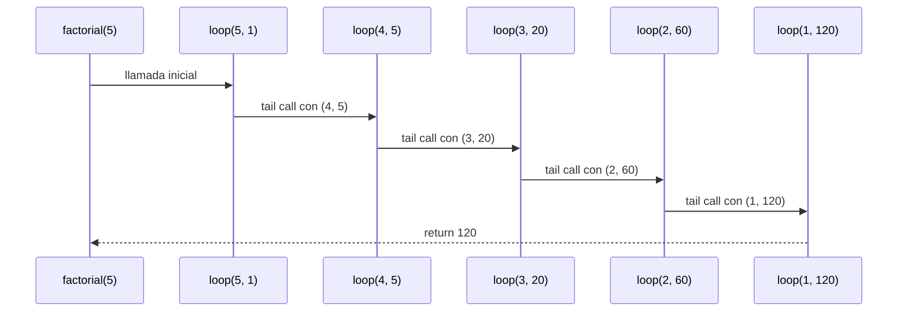
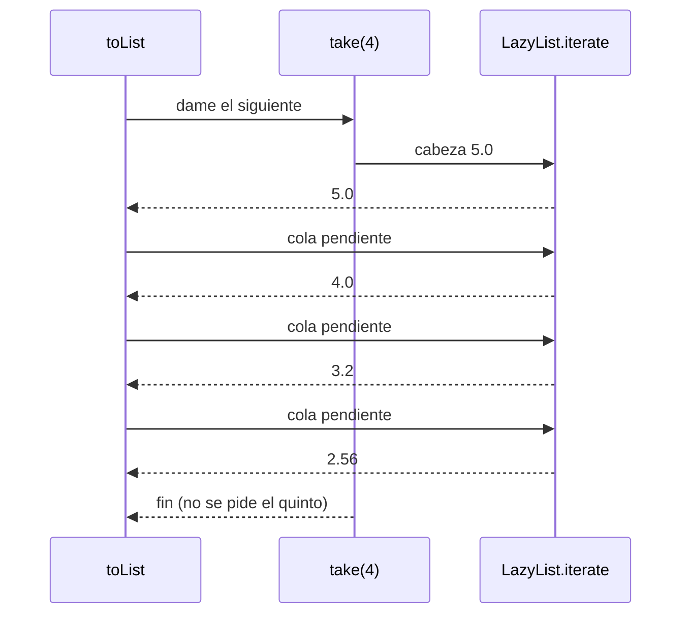

# Algoritmo Factorial con Recursión de Cola

## Definición del Algoritmo

```Scala
def factorial(n: Int): BigInt = {
  @annotation.tailrec
  def loop(x: Int, acumulador: BigInt): BigInt = {
    if (x <= 1) acumulador
    else loop(x - 1, acumulador * x)
  }
  loop(n, 1)
}
```

* La función `factorial` calcula el factorial de un número `n` utilizando **recursión de cola**.
* La función interna `loop` es la que hace la recursión:

  * Recibe dos parámetros:

    * `x`: el valor actual decreciente hasta llegar a 1.
    * `acumulador`: donde se guarda el resultado parcial en cada paso.
* El decorador `@annotation.tailrec` obliga a que la función sea optimizada como recursión de cola, es decir, **no se acumulan llamados en la pila**.

## Explicación paso a paso

### Caso base

```Scala
if (x <= 1) acumulador
```

Cuando `x` llega a `1`, la función retorna directamente el valor acumulado, evitando más llamadas.

### Caso recursivo

```Scala
loop(x - 1, acumulador * x)
```

En cada llamada:

* Se reduce el valor de `x` en 1.
* Se multiplica el acumulador por `x` y se pasa a la siguiente iteración.
* Como es recursión de cola, la llamada recursiva es la **última instrucción** en ejecutarse, lo que permite a Scala optimizar la pila.

---

## Llamados de pila en recursión de cola

Ejemplo:

```Scala
factorial(5)
```

### Paso 1: Llamada inicial

```Scala
loop(5, 1)
```

### Paso 2: Primera iteración

```Scala
loop(4, 5)   // acumulador = 1 * 5
```

### Paso 3: Segunda iteración

```Scala
loop(3, 20)  // acumulador = 5 * 4
```

### Paso 4: Tercera iteración

```Scala
loop(2, 60)  // acumulador = 20 * 3
```

### Paso 5: Cuarta iteración

```Scala
loop(1, 120) // acumulador = 60 * 2
```

### Paso 6: Caso base

```Scala
return 120
```

---

## Diferencia con recursión normal

* En **recursión normal** cada llamada queda en la pila esperando a que termine la siguiente, lo que puede causar desbordamiento si `n` es muy grande.
* En **recursión de cola**, el compilador transforma el proceso en un **bucle optimizado**, por lo que no se guarda cada llamada en la pila y el algoritmo puede ejecutarse para valores muy grandes sin problema.

---

## Ejemplo de uso

```Scala
val resultado = factorial(5)
println(resultado)  // 120
```

El resultado de `factorial(5)` es `120`.


## Diagrama de llamados de pila con recursión de cola



## Punto 4: réplicas perezosas

```scala
def replicas(magnitud: Double): LazyList[Double] =
  LazyList.iterate(redondear(magnitud))(x => redondear(x * 0.8))

def replicasSensibles(magnitud: Double, minimo: Double): List[Double] =
  replicas(magnitud).takeWhile(x => x > minimo).toList
```

Este punto no usa expresiones `for`, solo `LazyList.iterate` y `takeWhile`.

### Traza de `replicas(5.0).take(4).toList`

`LazyList.iterate(a)(f)` guarda la cabeza `a` y deja la cola como un cálculo
pendiente, `iterate(f(a))(f)`, que solo se ejecuta cuando alguien la pide.

| Paso | Qué se evalúa | Elementos calculados |
|---|---|---|
| 1 | `replicas(5.0)`: cabeza $5.0$, cola pendiente | $5.0$ |
| 2 | `take(4)`: no calcula nada, limita a 4 | $5.0$ |
| 3 | `toList` pide la cola: $\text{redondear}(5.0 \cdot 0.8)$ | $5.0,\ 4.0$ |
| 4 | pide la cola: $\text{redondear}(4.0 \cdot 0.8)$ | $5.0,\ 4.0,\ 3.2$ |
| 5 | pide la cola: $\text{redondear}(3.2 \cdot 0.8)$ | $5.0,\ 4.0,\ 3.2,\ 2.56$ |
| 6 | ya hay 4 elementos: `take` corta y no pide la cola | — |



### Por qué no agota la memoria

La secuencia es infinita solo como definición. En memoria existen únicamente
los elementos que ya se pidieron; el resto es una función pendiente. Con
`take(4)` se calculan 4 elementos. Una `List` infinita no podría construirse,
porque exigiría calcular todos los elementos antes de devolver nada.

### Traza de `replicasSensibles(5.0, 3.0)`

`takeWhile(_ > 3.0)` evalúa elemento por elemento:
$5.0 > 3.0$ sí, $4.0 > 3.0$ sí, $3.2 > 3.0$ sí, $2.56 > 3.0$ no, y se detiene.
Resultado: `List(5.0, 4.0, 3.2)`. El 2.56 se calcula pero no entra, y no se
calcula nada más allá.
